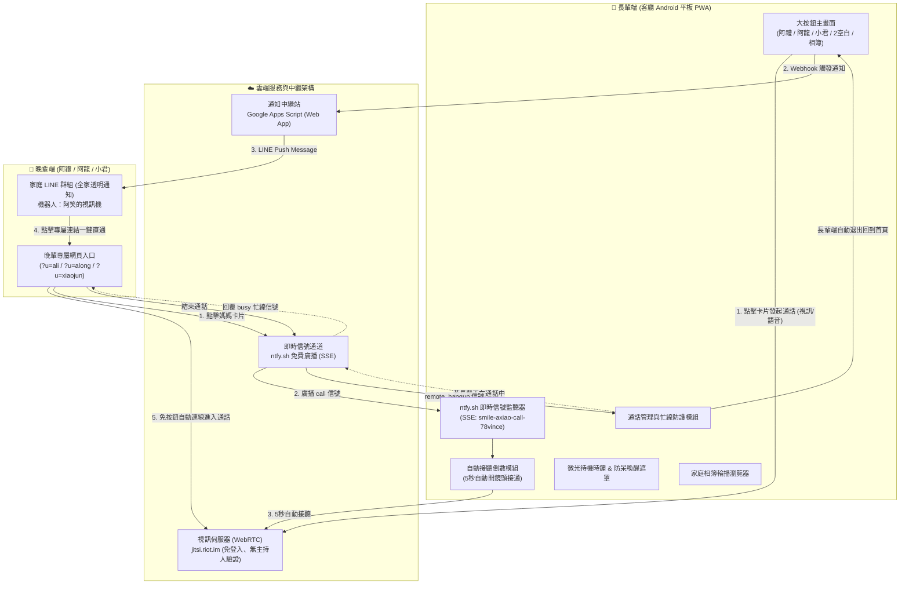

# Smile Video Call (微笑視訊) - 完整開發歷程與系統架構報告 (本地專屬紀錄)

> 專為高齡長輩量身打造的「零阻力、大按鈕、微光待機時鐘防呆喚醒、家庭相簿輪播、Jitsi 視訊/純語音雙模式、自動接聽、家庭 LINE 即時推播」視訊通話系統。
> ⚠️ **注意**：本技術報告僅存於本地專案目錄供維護與紀錄查閱，不對外公開上線。

---

## 一、專案緣起與設計哲學

### 1. 痛點剖析
在日常照護高齡長輩時，常見通訊軟體（如 LINE、FaceTime、Zoom、Google Meet）存在著巨大的人機互動障礙：
- **操作層級過深**：長輩不易找到通話按鈕，常誤觸其他功能。
- **認證與登入頻繁**：長時間放置的平板容易被強制登出或跳出密碼驗證。
- **接聽與掛斷難度高**：來電滑動解鎖或小掛斷鈕對長輩視力與手指靈巧度不友善。
- **幽靈分身與房間干擾**：未完全關閉的視訊常留下分身，或新來電直接打斷正在進行的通話。
- **平板待機黑屏**：休眠後長輩誤以為機器損壞，且喚醒時容易因誤觸畫面直接撥出電話。

### 2. 核心設計原則
- **超大視覺與極簡無框設計**：150px 大頭貼 + 超大姓名 + 單色清晰視訊與通話雙鍵。
- **免帳號、免登入**：採用開源無主持人登入限制的 WebRTC 視訊引擎 (`jitsi.riot.im`)。
- **長輩端零操作**：晚輩撥號時，長輩平板**自動響鈴並倒數自動接通**。
- **微光時鐘防呆喚醒**：低亮度、防烙印黑底微光時鐘；觸碰喚醒時加入 800ms 防呆冷卻，絕不誤撥電話。
- **家庭相簿數位相框**：平時可當作客廳數位相框，支援 5 秒自動輪播與手勢滑動翻頁。
- **雙向同步與通話守護**：晚輩掛斷時長輩自動返回首頁；長輩通話中自動提示其他家人「忙線中」。
- **全家透明聯防**：透過 Google Apps Script 橋接，長輩一撥號，**家庭 LINE 群組全員立刻收到直通通知**。

---

## 二、系統整體架構圖

---

## 三、八大開發階段演進紀錄 (完整時間戳)

### 階段 1：基礎架構與大按鈕高對比 UI
- **時間**：`2026-10-28 10:30 ~ 12:00`
- **建置 PWA 離線漸進式應用**：包含 `manifest.json`、`sw.js`、高解析度圖示，支援安裝至 Android 平板主畫面。
- **長輩親和排版**：採用 28px 圓角大卡片、110px 大頭貼、Dicebear SVG 虛擬頭像，搭配全螢幕時鐘與日期。
- **常駐螢幕防休眠**：整合 Screen Wake Lock API，通話期間與待機期間避免平板黑屏。

### 階段 2：攻克 Jitsi Meet 主持人登入卡點
- **時間**：`2026-10-28 14:00 ~ 15:30`
- **原問題**：官方預設 `meet.jit.si` 於近年改版，強制要求房間第一位進入者必須使用 Google / GitHub 帳號登入作為會議主持人，導致長輩與晚輩畫面皆卡在「等待主持人開會」。
- **技術決策**：棄用官方 `meet.jit.si`，切換為由開源社群維護、完全開放且免登入的伺服器 **`jitsi.riot.im`**。
- **成效**：任何一方進入房間皆不需驗證身分，鏡頭與麥克風瞬間自動開啟。

### 階段 3：家庭多角色中心化架構（1 長輩對多晚輩）
- **時間**：`2026-10-28 16:00 ~ 17:30`
- **架構設計**：
  - 核心角色：**阿笑** (`axiao`，長輩客廳機)。
  - 晚輩角色：**阿禮** (`ali`，大兒子)、**阿龍** (`along`，二兒子)、**小君** (`xiaojun`，孫女)。
- **專屬房間與直通參數**：
  - 各自獨立通話房間：`smile-axiao-ali`、`smile-axiao-along`、`smile-axiao-xiaojun`。
  - 支援 URL 參數直通：`?u=ali&join=axiao`，晚輩點擊通知後**不需要再次手動點選撥號**，系統自動開鏡頭連進房間。

### 階段 4：即時信號通道與長輩端「自動接聽」
- **時間**：`2026-10-28 19:00 ~ 20:30`
- **長輩零操作接聽**：整合 `ntfy.sh` 免費 SSE 即時通道（`smile-axiao-call-78vince`）。
- **流程體驗**：
  1. 晚輩在手機點擊「阿笑媽媽」，向信號通道廣播 `{ action: "call", caller: "ali", target: "axiao" }`。
  2. 長輩平板收到 SSE 事件，立刻播放電話響鈴音效，畫面上浮現 5 秒倒數進度條。
  3. 5 秒倒數結束後，長輩端**自動調用 Jitsi API 加入視訊房間**，長輩完全無須點擊任何按鈕。

### 階段 5：視訊通話體驗與極致邊界處理
- **時間**：`2026-10-28 21:00 ~ 22:30`
- **消滅「雙媽媽幽靈分身」**：
  - 掛斷時先執行 `executeCommand('hangup')`，延遲 500ms 待伺服器確認離線後再銷毀 DOM，徹底杜絕幽靈分身。
- **通話中忙線保護（Busy Protection）**：
  - 若長輩正與阿禮通話中，阿龍此時撥號，長輩端不會中斷通話，而是由平板自動回傳 `{ action: "busy" }` 信號。
  - 阿龍的手機端會彈出溫馨提示：「阿笑媽媽目前正在與【阿禮】視訊中，請稍候再撥！」
- **遠端掛斷同步**：
  - 晚輩掛斷或因網路離開房間時（`participantLeft`），長輩平板自動結束通話，清空鏡頭並乾淨返回大按鈕首頁。

### 階段 6：平板響應式排版與底部狀態列常駐鎖定
- **時間**：`2026-10-29 09:30 ~ 10:30`
- **問題**：平板在橫向矮螢幕或重新整理後，中間聯絡人卡片因 Flexbox 未設 `min-height: 0` 而撐大，將最底部的連線綠燈與 ⚙️ 設定按鈕擠出螢幕外。
- **修復**：
  - 底部列 `.app-footer` 設定 `flex-shrink: 0`、白色圓角底卡與立體陰影，**永遠釘在螢幕最下方**。
  - 聯絡人容器加上 `min-height: 0` 與 `overflow-y: auto`，矮螢幕時自動產生內部滑動，確保頂部時鐘與底部狀態列絕對不消失。
  - 頂部加入「🔄 重新整理」按鈕，解決 Android PWA 安裝後難以手動刷新快取的問題。

### 階段 7：LINE Messaging API + Google Apps Script (GAS) 家庭群組中繼站
- **時間**：`2026-10-29 11:00 ~ 12:30`
- **全面取代即將停用的 LINE Notify**：改採 LINE 官方帳號（LINE Official Account）+ Messaging API。
- **免架伺服器中繼站**：撰寫專屬 `google-apps-script-line.js`，部署於 Google 免費雲端。
- **智慧群組自動綁定**：
  - 機器人被邀請進家庭群組時，自動擷取 `event.source.groupId` 並持久化儲存於 `ScriptProperties`。
  - 長輩撥號時，Google 腳本自動將來電通知推播至家庭 LINE 群組。
- **全家統一設定**：將此 Webhook 寫入專案核心設定，所有晚輩統一由「阿笑的視訊機」機器人在家庭群組發送通知。

### 階段 8：微光防呆喚醒、家庭相簿輪播、主畫面無框設計與純語音通話模式
- **時間**：`2026-10-29 14:30 ~ 15:00`
- **微光待機時鐘防呆喚醒（Anti-Dialing Screensaver）**：
  - 閒置 3 分鐘進入黑底微光待機時鐘，防烙印且維持插電常亮。
  - 採用全螢幕遮罩 `#screensaver-overlay` 攔截點擊，喚醒時加入 800ms 防誤觸冷卻期，喚醒瞬間絕對不誤觸底下的撥號卡片。
- **家庭相簿輪播功能**：
  - 嵌入 Google 相簿公開照片，平時可作為溫馨的家庭數位相框。
  - 支援 5 秒自動輪播、觸控螢幕左右手勢滑動翻頁（Swipe Left/Right）、上一張/下一張按鈕與指示圓點。
- **主畫面版型極簡化**：
  - 卡片無外框、無底色、無陰影；大頭照尺寸擴大至 150px、無外框、無陰影；移除「點我通話」小標籤。
- **Jitsi 視訊與純語音雙模式**：
  - 姓名下方配置視訊鏡頭與電話單色 SVG 圖示，不使用 emoji。
  - 支援 Jitsi `startAudioOnly: true` 與 `startWithVideoMuted: true` 純語音連線。
- **預設六功能槽排版**：
  - 三位人物（阿禮、阿龍、小君）、兩個空白預留槽、一個家庭相簿（放置在最後），3 欄 × 2 列優雅平衡。

### 階段 9：相簿極簡全螢幕化、平板動態可視高度鎖定、語音通話頭像化、即時信號通道解析修復
- **時間**：`2026-10-29 15:00 ~ 15:30`
- **相簿功能精簡極大化**：
  - 僅使用 Google 相簿公開相片，移除本地生活照與文字說明；移除開啟 Google 相簿之外部連結。
  - 相片最大化滿版展示 (`100vw x 100vh`)，移除左上角「家庭相簿」文字、張數數字及 Icon。
  - 底部指示點改為扁平單色無立體效果；相簿播放期間維持 WakeLock 不休眠。
  - 增設 10 分鐘自動超時防呆：相簿播放滿 10 分鐘自動退出相簿並進入微光待機時鐘模式。
- **平板底欄齒輪與綠燈常駐修復**：
  - 導入 `--app-height: window.innerHeight` 與 `position: fixed; inset: 0;`。
  - 聯絡人大頭貼改採 `clamp(75px, 14.5vh, 125px)` 彈性縮放，徹底杜絕平板在重新整理或瀏覽器網址列彈出時，將底端設定齒輪與連線指示燈擠出螢幕外的問題。
- **語音通話頭像化（杜絕字母圓形圖示）**：
  - 各身分全面配置 PNG 格式頭像並寫入 Jitsi `userInfo.avatarURL` 與 `avatarUrl` 指令。
  - 語音通話期間在視訊容器上方展示專屬大頭貼與動態音波脈衝畫面，徹底取代 Jitsi 原生之字母圓形。
- **修復晚輩撥打長輩功能**：
  - 徹底解決 `ntfy.sh` SSE 內部 `raw.message` 字串二次解析問題，恢復長輩平板毫秒級自動響鈴與 5 秒倒數自動接聽功能。

---

## 四、關鍵技術規格一覽表

| 項目 | 技術 / 服務 | 說明 |
| :--- | :--- | :--- |
| **前端架構** | 靜態純原生 HTML5 / CSS3 / Vanilla JS | 零建置負擔、極高渲染效能、最適合老舊平板 |
| **PWA 支援** | Service Worker (`sw.js`) + Manifest | 支援離線快取 Shell、鎖定直向/橫向自適應 |
| **視訊與語音** | Jitsi Meet External API (`jitsi.riot.im`) | 免費開源、免登入、支援視訊與純語音雙模式 |
| **即時信號** | `ntfy.sh` (SSE: `smile-axiao-call-78vince`) | 免費公共信號通道，負責自動接聽、忙線、同步掛斷 |
| **家屬通知** | Google Apps Script (Web App) + LINE Bot | 負責自動記錄家庭群組 ID 並主動 Push 訊息 |
| **微光防呆** | 全局捕捉攔截 + 800ms 防觸發冷卻 | 待機防烙印時鐘，點擊喚醒時徹底阻斷通話誤觸 |
| **家庭相簿** | Google Photos 嵌入 + Touch Swipe | 5秒自動輪播、手勢左右滑動翻頁、數位相框 |
| **防休眠模組** | Screen Wake Lock API | 保持長輩平板待機時螢幕常亮，不進入省電休眠 |
| **音訊引擎** | Web Audio API (Synthesizer) | 原生代碼動態合成撥號等待音與來電和弦響鈴 |

---

## 五、專屬網址與部署配置清單

### 1. 系統公開網址
- **線上運行網址 (GitHub Pages)**：  
  [`https://78vince.github.io/smile-video-call/`](https://78vince.github.io/smile-video-call/)
- **GitHub 原始碼倉庫**：  
  [`git@github.com:78vince/smile-video-call.git`](https://github.com/78vince/smile-video-call)

### 2. 各家庭身分直通專屬網址
- 👵 **阿笑（長輩平板）**：  
  `https://78vince.github.io/smile-video-call/?u=axiao`
- 👦 **阿禮的手機**：  
  `https://78vince.github.io/smile-video-call/?u=ali`
- 🧑 **阿龍的手機**：  
  `https://78vince.github.io/smile-video-call/?u=along`
- 👧 **小君的手機**：  
  `https://78vince.github.io/smile-video-call/?u=xiaojun`

### 3. LINE 機器人與中繼站配置
- **LINE 官方帳號**：`阿笑的視訊機`（Basic ID: `@355pvwuh`）
- **Google Apps Script Web App 網址**：  
  `https://script.google.com/macros/s/AKfycbwFd5_E2nJ14Dmf6ZNuqTgaxWrVtJRNeQLL8wPcYyaEC3ZGa8X9Xs8j_gMfDeO-V9ZZAQ/exec`

---

## 六、維護與日常使用指南

1. **平板端維護**：
   - 建議使用 Chrome 瀏覽器開啟長輩網址後，點擊「加入主畫面」安裝成 PWA 全螢幕應用。
   - 若未來專案程式碼有更新，只要在網頁頂部點擊一次 **「🔄 重新整理」**，Service Worker 會自動清除快取並載入最新版。
2. **LINE 免費額度說明**：
   - LINE 官方帳號免費方案每月提供 **200 則主動發送訊息** 額度。
   - 由於訊息是直接發送至「家庭群組」，每次長輩撥號只會扣除 1 則額度（無論群組內有多少位家人）。長輩每天撥打 1～5 次（每月約 30～150 則）完全落在免費額度內。
3. **新增或修改照片**：
   - 可在 `config.js` 的 `albumPhotos` 陣列中新增相片網址與說明，或使用 Google 相簿公開連結同步新增。
