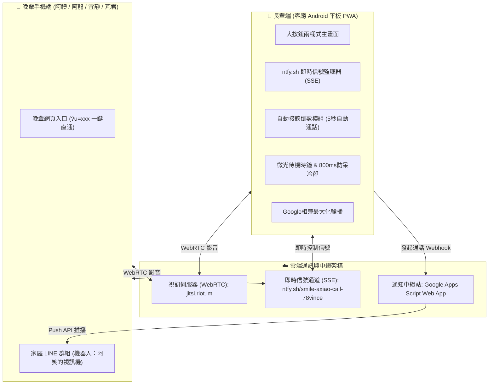

# 微笑視訊 (Smile Video Call) — 專案工作交接文件 (HANDOFF)

> **最後更新**：2026-10-30 15:45（台北時間）  
> **目前版本**：`smile-call-v30` (Phase 1～23 全部完成並正式上線)  
> **線上站點**：<https://78vince.github.io/smile-video-call/>  
> **GitHub 倉庫**：`git@github.com:78vince/smile-video-call.git`（分支：`main`）  
> **專案位置**：`Jitsi Meet/Smile Video Call/`  

---

## 一、專案定位與核心設計原則

### 1. 專案背景與痛點
專為高齡長輩（阿笑）量身打造的家庭專用視訊通話 PWA。日常照護長輩時，常見通訊軟體（LINE、FaceTime、Zoom 等）存在操作層次過深、常被強制登出、來電解鎖按鈕過小、平板黑屏休眠後誤觸撥號等障礙。

### 2. 核心設計哲學
1. **零阻力、長輩端零操作**：晚輩撥號時，長輩平板自動響鈴並倒數 5 秒自動開啟視訊鏡頭接聽，長輩完全不需點擊任何接聽鍵。
2. **免帳號、免驗證**：採用開源無主持人登入限制的 WebRTC 引擎 (`jitsi.riot.im`)，無密碼或過期踢除問題。
3. **客廳生活伴侶（相簿＋微光時鐘）**：
   - **家庭相簿**：自動同步 Google 相簿，支援 5 秒自動輪播與手勢滑動翻頁，閒置 10 分鐘自動進入微光模式。
   - **微光待機時鐘**：純黑底防烙印時鐘遮罩，長輩碰觸喚醒時設有 **800ms 全局防呆攔截**，絕不誤撥電話。
4. **全家透明 LINE 聯防**：透過 Google Apps Script 橋接，長輩在平板點擊任何晚輩通話，**家庭 LINE 群組全員即刻收到直通連結**。
5. **雙向同步與通話忙線保護**：晚輩掛斷時長輩自動返回首頁；長輩通話中，其他家人撥打會自動提示「阿笑媽媽通話中，請稍候」。

---

## 二、目前系統架構與各端專屬入口

### 1. 系統服務分工架構

### 2. 各家庭身分專屬直通網址

| 身分 | 角色說明 | 專屬直通網址 | 預設視訊房間 |
|---|---|---|---|
| 👵 **阿笑** | 客廳平板專用（大頭貼、自動接聽、相簿） | `https://78vince.github.io/smile-video-call/?u=axiao` | `smile-axiao-*` |
| 👦 **阿禮** | 大兒子手機專用（直通長輩） | `https://78vince.github.io/smile-video-call/?u=ali` | `smile-axiao-ali` |
| 🧑 **阿龍** | 二兒子手機專用（直通長輩） | `https://78vince.github.io/smile-video-call/?u=along` | `smile-axiao-along` |
| 👩 **宜靜** | 晚輩手機專用（直通長輩） | `https://78vince.github.io/smile-video-call/?u=yijing` | `smile-axiao-yijing` |
| 👧 **芃君** | 孫女手機專用（直通長輩） | `https://78vince.github.io/smile-video-call/?u=pengjun` | `smile-axiao-pengjun` |

---

## 三、現行主畫面介面規格 (Phase 18～23)

### 1. 兩欄式格局（阿笑平板端）
- **左欄（生活功能 Dock）**：
  - **家庭相簿**與**微光待機模式**垂直排列。
  - 純大圓形精緻封面，**不放文字標籤**，點擊直接進入相簿輪播或微光時鐘。
  - 尺寸固定為精巧的 **120px × 120px**（`clamp(95px, 16vh, 120px)`），常駐左側不隨聯絡人捲動。
- **中隔**：細柔淡灰色分隔線（`.dashboard-divider`，`1.5px solid #e2e8f0`），視覺自然分區。
- **右欄（家人聯絡人清單）**：
  - 目前橫排展示 4 位家人（阿禮、阿龍、宜靜、芃君）。
  - **大頭貼尺寸**：精準定調為 **200px × 200px**（`clamp(140px, 26vh, 200px)`），附 3px 柔白立體光暈。
  - **欄位間距**：縮小為緊湊的 `clamp(6px, 1vw, 14px)`。
  - **垂直上下滾動架構**：採用 `overflow-y: auto; overflow-x: hidden;`，目前 4 人水平居中；**未來新增第 5、6 位家人時自動排入第二列，支援滑動向上/向下瀏覽**。
  - **獨立通話大按鈕**：每位聯絡人下方備有加大版「視訊通話（鮮藍 `#2563eb`）」與「語音通話（翡翠綠 `#16a34a`）」雙按鈕，兩鍵間距拉寬至 `20px` 防誤觸。

### 2. 頂部一列式功能列
- **連線狀態整合**：移除底部冗餘狀態列，將連線指示燈號（在線鮮綠燈）直接整合進身分按鈕（`身分：阿笑 ▾`）。
- **無雜訊**：移除原先「點一下照片...」副標題。
- **單色 SVG 按鈕**：
  - 🌙 微光模式（快速進入待機時鐘）
  - 🔄 強制重新整理（清除 Service Worker 快取並重載最新版）
  - ⛶ 全螢幕切換（手動進出全螢幕）
  - 數字時鐘與日期

### 3. 全螢幕機制
- `manifest.json` 宣告 `"display": "fullscreen"`。
- 核心腳本實作**首觸自動全螢幕**：長輩第一次摸到平板螢幕任何位置即自動啟動 Fullscreen API 隱藏 Android 系統狀態列。

---

## 四、LINE 官方帳號與 Google Apps Script 中繼站

### 1. 配置參數
- **LINE 官方帳號**：`阿笑的視訊機`（Basic ID: `@355pvwuh`）
- **綁定家庭群組 ID**：`Cbaa9407dcce090399acdf70d6b344200`
- **GAS 中繼站網址**：  
  `https://script.google.com/macros/s/AKfycbwFd5_E2nJ14Dmf6ZNuqTgaxWrVtJRNeQLL8wPcYyaEC3ZGa8X9Xs8j_gMfDeO-V9ZZAQ/exec`
- **中繼站原始碼**：[`google-apps-script-line.js`](file:///Users/vkimac/Documents/VK%20Agent/Jitsi%20Meet/Smile%20Video%20Call/google-apps-script-line.js)

### 2. 關鍵注意事項（防插嘴設定）
- 群組 ID 已固定鎖定在程式碼中。
- 家人在群組聊天時，機器人**絕對不會自動插嘴回覆**（已移除聊天訊息的 auto-reply）。
- 僅在長輩於平板端按下撥號時，中繼站才會使用主動推播（Push API）發送直通來電通知。
- **免費額度**：LINE 官方帳號每月提供 200 則免費主動推播訊息；因直接推送至家庭群組，每次長輩通話僅計 1 則，日常使用完全充足。

---

## 五、Android 平板端維護與遠端控制

1. **AnyDesk 遠端控制**：
   - 平板端已安裝 AnyDesk 與控制插件（ad1）。
   - Android 設定中已開啟「無障礙功能」之 AnyDesk Control Service，Mac 端可直接點擊與滑動操控平板。
2. **Android ADB 偵錯工具**：
   - 位於 Mac 本機 `~/platform-tools/adb`，已設定環境變數至 `~/.zshrc`。
   - 可隨時透過 USB 或區網 WiFi 進行 ADB 深度調控。
3. **PWA 更新方式**：
   - 當程式庫有代碼更新並推至 GitHub 後，在平板點擊頂部功能列右側的 **「🔄 重新整理單色按鈕」**，Service Worker 會自動註銷舊快取並下載最新版本。

---

## 六、歷次開發演進紀錄摘要 (Phase 1～23)

| 階段 | 時間 | 主要內容 | 快取版本 |
|---|---|---|---|
| **Phase 1-4** | 2026-10-28 | 專案初始化、Jitsi WebRTC 串接、大字大頭貼、防呆響鈴音效 | `v1~v4` |
| **Phase 5-8** | 2026-10-29 | 雙向同步掛斷、ntfy 信號通道、GAS LINE 機器人推播、微光待機時鐘 | `v5~v8` |
| **Phase 9-12** | 2026-10-29 | Google 相簿 5 秒自動輪播、手勢滑動、防誤觸喚醒冷卻 (800ms) | `v9~v14` |
| **Phase 13-17** | 2026-10-29 | 新增宜靜/芃君、純語音通話模式、後台管理頁面 `admin.html`、四欄佈局 | `v15~v24` |
| **Phase 18** | 2026-10-30 | 主畫面兩欄式重構、頂部一列收納、低彩度 Slate 配色、首觸全螢幕 | `v25` |
| **Phase 19-21** | 2026-10-30 | 頭像放大測試 (180px ➜ 220px ➜ 320px) 與生活功能 180px 調適 | `v26~v28` |
| **Phase 22** | 2026-10-30 | 生活功能鎖定 120px、頭像 240px、水平滾動架構實作 | `v29` |
| **Phase 23** | 2026-10-30 | 依需求定調：**垂直上下滾動**、**頭像直徑 200px**、**間距縮小緊湊**、生活功能 120px | `v30` |

---

## 七、交接待辦與後續建議

- [ ] **平板現場交付**：下週攜帶平板返家交付長輩時，確認客廳 WiFi 連線品質與全螢幕 PWA 圖示啟動狀態。
- [ ] **新增家庭成員預備**：若日後需要新增第 5 位家人（例如其他親戚），只需在 `config.js` 的 `roles.axiao.contacts` 加入物件與大頭照，右欄會自動垂直向下排入第二列，長輩可順暢上下滑動。
- [ ] **相簿維護**：家人隨時可將新相片上傳至 Google 相簿公開連結，平板開啟相簿時會自動從雲端增量同步。
